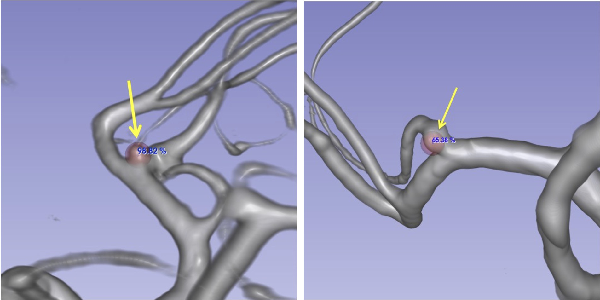
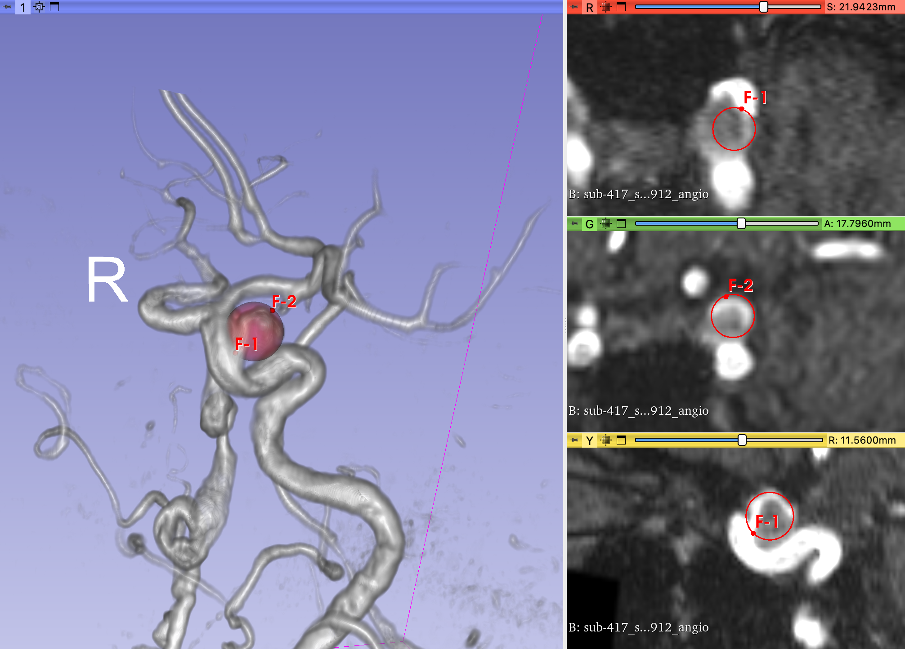

> **Note:** This repository is a copy of the original code hosted at [gitlab.inria.fr/yassis/DeepAneDet](https://gitlab.inria.fr/yassis/DeepAneDet), developed during my PhD at Inria/LORIA.

# DeepAneDet

[](https://github.com/youssefassis/DeepAneDet/actions/workflows/ci.yml)

Detection of intracranial aneurysms in 3D Time-of-Flight MRA as an object detection problem: a 3D single-stage,
anchor-free network predicts each aneurysm as a sphere. This is the code and the annotations of the paper
["Intracranial Aneurysm Detection: An object detection perspective"](https://doi.org/10.1007/s11548-024-03132-z)
(IJCARS 2024), packaged as a set of commands that go from scans to detections and evaluation metrics.

## Method
Each aneurysm is approximated by a sphere defined by two points. The network divides each 3D patch into a grid of
cells; every cell predicts the confidence that an aneurysm is centered in it, the position of that center and the
sphere's radius. The data strategy of [DeepAneSeg](https://github.com/youssefassis/DeepAneSeg) tackles the class
imbalance: fast two-point annotation, negative patches centered on vessels and in the parenchyma, and aneurysm patches
duplicated and deformed. On 402 subjects, the method reached an average precision of 78.96%, a sensitivity of 86.78%
and 0.53 false positives per case, comparable or superior to the SCPM-Net [1], nnDetection [2] and nnU-Net [3]
baselines.

<details>
<summary>Abstract</summary>

Intracranial aneurysm detection from 3D Time-Of-Flight Magnetic Resonance Angiography images is a problem of
increasing clinical importance. Recently, a streak of methods have shown promising performance by using segmentation
neural networks. However, these methods may be less relevant in a clinical settings where diagnostic decisions rely
on detecting objects rather than their segmentation. We introduce a 3D single-stage object detection method tailored
for small object detection such as aneurysms. Our anchor-free method incorporates fast data annotation, adapted data
sampling and generation to address class imbalance problem, and spherical representations for improved object
detection. A comprehensive evaluation was conducted, comparing our method with the state-of-the-art SCPM-Net[1],
nnDetection[2] and nnUNet[3] baselines, using two datasets comprising 402 subjects, including one public dataset [4].
The evaluation used adapted object detection metrics. Our method exhibited comparable or superior performance, with
an average precision of 78.96%, sensitivity of 86.78%, and 0.53 false positives per case. Our method significantly
reduces the detection complexity compared to existing methods, and highlights the advantages of object detection
over segmentation-based approaches for aneurysm detection. It also holds potential for application to other small
object detection problems.
</details>

Detected aneurysms (red spheres) and their confidence:



## Quick start
```
git clone https://github.com/youssefassis/DeepAneDet && cd DeepAneDet
uv sync --extra cu126                                         # or --extra cpu, see Installation
uv run deepanedet-remove-skull data_dir=Data                  # lay out your data as in Data
uv run deepanedet-extract-points data_dir=Data
uv run deepanedet-train data_dir=Data data.split_file=reproducibility/fold1.json name=fold1
uv run deepanedet-predict train_dir=Data/0Work/fold1
uv run deepanedet-evaluate train_dir=Data/0Work/fold1 predictions=Data/0Work/fold1/prediction/200_epochs
```
Each step is described in [Usage](#usage), and its results in [Outputs](#outputs).

## Installation
The project uses [uv](https://docs.astral.sh/uv/) and Python 3.10+. From the repository folder, pick the PyTorch
build:
```
uv sync --extra cu126    # NVIDIA GPU (CUDA 12.6)
uv sync --extra cpu      # CPU only, also the build used on macOS
```
This creates `.venv` with the exact versions of `uv.lock`. Commands then run with `uv run`, or directly once `.venv`
is activated.

Without uv, `pip install git+https://github.com/youssefassis/DeepAneDet` installs the package and its commands
(with PyTorch's default build from PyPI).

## Data
### Layout
Each patient is a folder, either `P0001`-like or `sub-XXX/ses-YYYYMMDD` as in the public dataset [4]:
```
Data/
  P0001/
    volume.nii.gz    TOF-MRA scan
    aneurysms.csv    aneurysms: two points (x, y, z columns, in mm) per aneurysm, see Annotation
    config.json      {"init volume": "volume.nii.gz"}
    noskull.nii.gz   skull-stripped scan (written by deepanedet-remove-skull)
    points.csv       negative patch centers (written by deepanedet-extract-points)
  sub-013/
    ses-20101220/
  ...
  0Work/             trainings and logs (see Outputs)
```
Patients without aneurysm have no `aneurysms.csv`. Coordinates are in the scanner (RAS) space of the NIfTI file. A
split file lists the training, validation and testing patient folders, relative to the data folder or absolute, as in
`reproducibility/fold1.json`.

## Annotation
Each aneurysm is approximated by a sphere defined by two points: the center of its neck (F1) and its dome (F2).



## Usage
**1. Preprocessing:** skull-strip the scans, then select the negative patch centers.
```
uv run deepanedet-remove-skull data_dir=Data
uv run deepanedet-extract-points data_dir=Data
```

**2. Training:** on the training patients, with the validation loss computed after each epoch; outputs go to
`Data/0Work/fold1`, and running the same command again resumes the training.
```
uv run deepanedet-train data_dir=Data data.split_file=reproducibility/fold1.json name=fold1
```

**3. Prediction:** writes the detections of each validation and testing patient, with the last checkpoint by
default, to `prediction/<epochs>_epochs`. Each detection has a center (x, y, z) and a radius in mm, and a confidence
between 0 and 1.
```
uv run deepanedet-predict train_dir=Data/0Work/fold1        # checkpoint=best_checkpoint.pytorch tta=false
```

**4. Evaluation:** matches the detections, from the most to the least confident, to the aneurysm they overlap most
(IoU ≥ 0.1), and writes a CSV table of the detections and a summary figure next to the predictions.
```
uv run deepanedet-evaluate train_dir=Data/0Work/fold1 predictions=Data/0Work/fold1/prediction/200_epochs
```

## Configuration
Settings are [Hydra](https://hydra.cc) configs in `deepanedet/configs/`: one file per command, composed from groups
(`data`, `model`, `optimizer`, `scheduler`, `augmentation`). Any value can be overridden on the command line:
```
uv run deepanedet-train data_dir=Data data.split_file=split.json name=exp2 batch_size=8 optimizer.lr=5e-3
uv run deepanedet-train --cfg job --resolve data_dir=Data data.split_file=split.json name=exp2    # print the config
```
To add an alternative, e.g. another optimizer, add a file with a `_target_` class to the group, such as
`deepanedet/configs/optimizer/adam.yaml`, and select it with `optimizer=adam`.

Runs are reproducible: `seed` (0 by default) fixes the training, and each training records its git commit and library
versions in `run_info.json`. For identical GPU runs, also set `deterministic=true` (slower).

## Outputs
Everything is written under `Data/0Work`:
```
logs/                            logs of the preprocessing commands
fold1/                           one training
  .hydra/config.yaml             resolved configuration, read back by deepanedet-predict and deepanedet-evaluate
  run_info.json                  git commit and library versions
  last_checkpoint.pytorch        model after the last epoch, used for prediction by default
  best_checkpoint.pytorch        model with the lowest validation loss
  <epoch>_checkpoint.pytorch     model every save_every (10) epochs
  logs/                          TensorBoard logs: uv run tensorboard --logdir Data/0Work
  train.log
  prediction/<epochs>_epochs/    for each validation and testing patient:
    <patient>.json                 detections (P0001.json, sub-013_ses-20101220.json)
    detection_evaluation@0.1.csv   matched detections, written by deepanedet-evaluate
    Evaluation@0.1.png             evaluation figure
```

## Requirements
- **Memory:** training keeps the training and validation scans in memory, 4 bytes per voxel: 150 MiB for a
  512×512×150 scan.
- **GPU:** the network has 28.8 M parameters (110 MiB). Its memory use comes mostly from the batch of 32 patches of
  96³ voxels, with mixed precision; if the GPU runs out of memory, lower `batch_size`.

## Reproducing the paper
- `reproducibility/annotations`: annotations of the public dataset [4], one JSON file per subject. Write them as the
  `aneurysms.csv` of each patient folder with:
  ```
  uv run deepanedet-convert-annotations annotations_dir=reproducibility/annotations data_dir=Data
  ```
- `reproducibility/fold1.json` to `fold5.json`: the 5-fold cross-validation splits, one training each:
  ```
  uv run deepanedet-train data_dir=Data data.split_file=reproducibility/fold1.json name=fold1
  ```
- `baselines`: the nnU-Net [3] and nnDetection [2] baselines (see its README).

## Development
```
uv run pytest               # tests
uv run ruff check .         # lint
uv run ruff format .        # formatting
```
The code is organised as follows:
```
deepanedet/
  cli/           commands
  configs/       Hydra configuration
  data/          patient data I/O, patch sampling, augmentation transforms
  volume/        patch extraction, sphere burning, point selection, skull stripping
  models/        single-stage sphere detection network
  training/      dataset, balanced batch sampler, losses, schedulers, trainer
  inference/     patch-wise prediction, detection matching and evaluation
reproducibility/ annotations of the public dataset and cross-validation splits
baselines/       nnU-Net and nnDetection baselines of the paper
```

## Citation
If you find this work useful, please cite the paper (also available from "Cite this repository" on GitHub):
```
@article{assis2024intracranial,
  title={Intracranial aneurysm detection: an object detection perspective},
  author={Assis, Youssef and Liao, Liang and Pierre, Fabien and Anxionnat, Ren{\'e} and Kerrien, Erwan},
  journal={International Journal of Computer Assisted Radiology and Surgery},
  volume={19},
  number={9},
  pages={1667--1675},
  year={2024},
  publisher={Springer},
  doi={10.1007/s11548-024-03132-z}
}
```

## References
[1] Xiangde et al., SCPM-Net: An anchor-free 3D lung nodule detection network using sphere representation and
center points matching. Medical Image Analysis 75, 102287 (2022).

[2] Baumgartner et al., nnDetection: A self-configuring method for medical object detection. MICCAI, pp. 530–539
(2021).

[3] Isensee et al., nnU-Net: a self-configuring method for deep learning-based biomedical image segmentation. Nature
Methods 18(2), pp. 203–211 (2021).

[4] Di Noto et al., Towards automated brain aneurysm detection in TOF-MRA: open data, weak labels, and anatomical
knowledge. Neuroinformatics, pp. 1–14 (2022).

## Acknowledgements
This work was funded by the Grand-Est Region and the University Hospital (CHRU) of Nancy, France.
